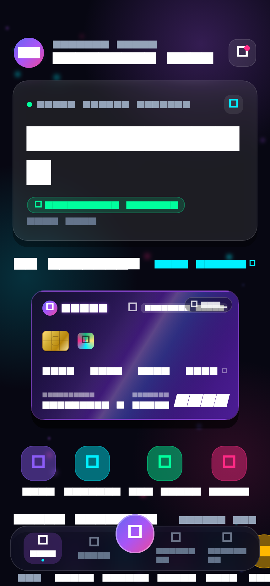
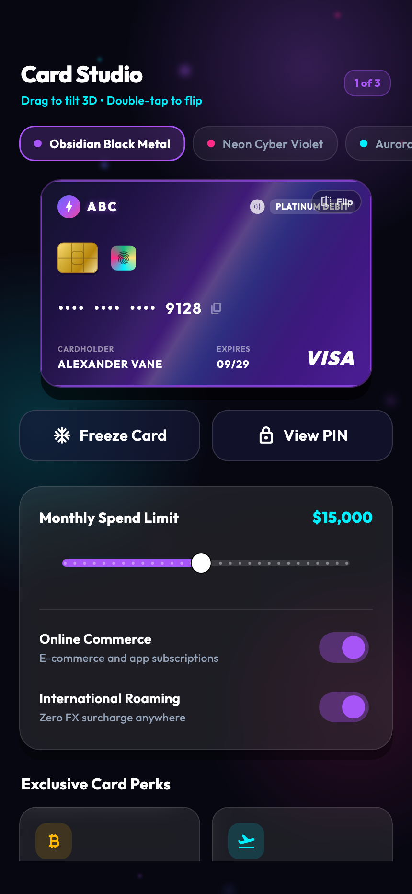
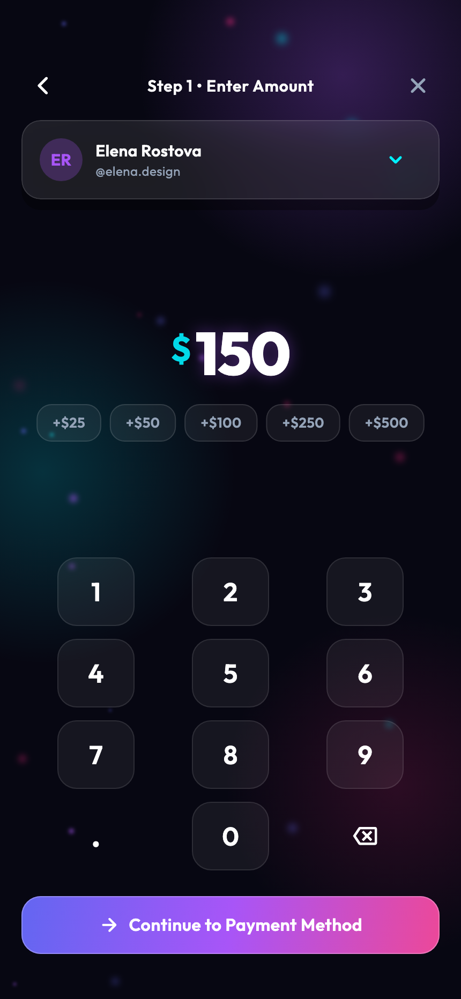
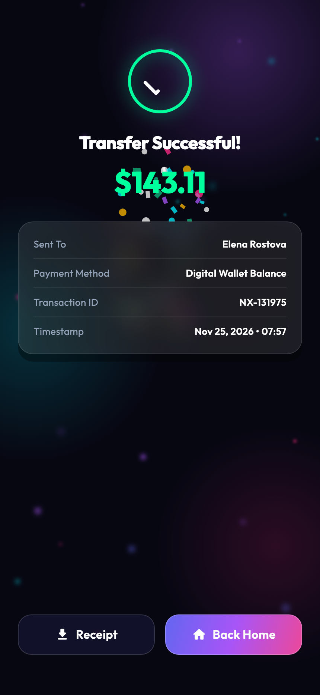
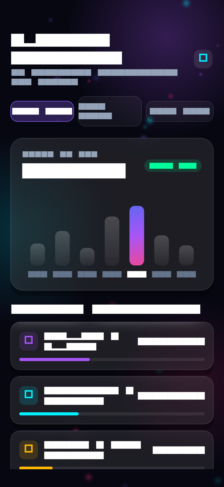
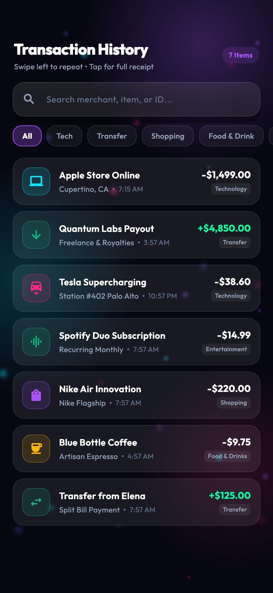

# ⚡ Digital Wallet & Payment App

<div align="center">


-success)

**A visually stunning, animation-first digital wallet and payments mobile application built with Flutter. Designed with a luxury futuristic fintech aesthetic, 3D interactive virtual cards, ambient glowing mesh lighting, physics-based particles, and a fluid 5-step payment flow.**

</div>

---

## 📱 App Screenshots

| 01. Wallet Dashboard | 02. 3D Card Studio | 03. Payment Keypad |
|:---:|:---:|:---:|
|  |  |  |
| *Animated balance counter, 3D card carousel, quick actions & spending breakdown* | *Interactive 3D tilt, 180° flip, freeze overlay, and limit slider* | *Large glowing amount display with custom haptic spring keypad* |

<br/>

| 04. Payment Success | 05. Spending Analytics | 06. Transaction Activity |
|:---:|:---:|:---:|
|  |  |  |
| *Animated checkmark drawing, celebratory confetti explosion & receipt* | *Interactive weekly neon bar chart & category progress meters* | *Instant search, category filters, swipe to repeat & receipt sheets* |

---

## ✨ Key Feature Highlights

### 1. 🌌 Visual Design & Ambient Atmosphere
- **Midnight & Electric Neon Palette:** Midnight obsidian (`#070712`) base with electric purple (`#8B5CF6`), cyber violet (`#A855F7`), neon cyan (`#00F0FF`), and emerald green (`#00FF9D`).
- **Dynamic Ambient Mesh:** Multi-layered radial glowing orbs providing subtle ambient lighting.
- **Continuous Floating Particles:** 60 FPS physics-based drifting particle canvas with variable speed and glowing blur filters.
- **Glassmorphic Surfaces:** Real-time `BackdropFilter` with Gaussian blur (`sigmaX: 16-24`), translucent gradient borders, and soft shadows.
- **Luxury Typography:** Space Grotesk / Outfit geometric sans typography with monospaced digital numbers.

### 2. 💳 Interactive 3D Virtual Cards (Hero Attraction)
- **3D Touch & Perspective Tilt:** Responds to finger drag using 4x4 matrix transforms (`Matrix4.identity()..setEntry(3, 2, 0.0012)..rotateX(..)..rotateY(..)`). Springs back smoothly with `Curves.easeOutBack` upon finger release.
- **Dynamic Holographic Sheen:** Dynamic specular gradient highlights that shift coordinates across the card surface in real-time as the card tilts.
- **Smooth 180° Flip Animation:** Double-tap or flip button to rotate the card in 3D:
  - **Front:** Authentic EMV gold micro-circuit chip, contactless waves, biometric hologram, masked card number with copy feedback, cardholder name, expiry, and network logo (Visa / Mastercard / Amex).
  - **Back:** Dark metallic magnetic stripe, authorized signature strip, CVV security box with show/hide toggle, customer concierge helpline, and holographic stamp.
- **Swipeable Card Stack Carousel:** Active card expands to full scale (1.0) while adjacent cards remain slightly behind (0.88 scale with depth offset).
- **Freeze / Unfreeze Effect:** Animated frosted glass overlay with geometric ice crystal spikes, blur filter, and glowing "CARD FROZEN" lock badge.
- **One-Tap Copy:** Tap card number to copy to clipboard with haptic feedback and animated confirmation badge.

### 3. 💸 5-Step Animated Payment Journey
- **Step 1 – Enter Amount:** Large animated digits with glow, custom tactile numeric keypad with spring press effect, quick amount chips (+$25, +$50, +$100, +$250, +$500), and recipient selector.
- **Step 2 – Select Payment Method:** Interactive source cards (Digital Wallet Balance, Quantum UPI, Obsidian Debit, Cyber Credit) with glowing borders and scale animations.
- **Step 3 – Payment Confirmation:** Glass summary breakdown (Recipient, Source, $0.00 Fee, 256-bit biometrics guarantee) and animated Pay Now button.
- **Step 4 – Payment Processing:** Rotating sweep gradient ring loader, pulsing circular aura, and sequential status messages (*Connecting Quantum Enclave* $\rightarrow$ *Authenticating Biometrics* $\rightarrow$ *Routing Zero-Knowledge Wire* $\rightarrow$ *Finalizing Cryptographic Receipt*).
- **Step 5 – Payment Success:** Full-screen celebration with an animated vector checkmark drawing, multi-colored confetti explosion, amount counter, digital receipt breakdown, simulated PDF receipt download, and return home button.

### 4. 📊 Dashboard, Analytics & Activity
- **Animated Counter:** Rolling balance counter (`$24,850.75`) with hide/reveal balance toggle.
- **Multi-Segment Spending Ring:** Circular animated progress indicator displaying expenditure percentages across Shopping, Tech, Dining, and Subscriptions.
- **Interactive Weekly Bar Chart:** Glowing neon vertical bars where tapping any day reveals that day's exact spending and trend tooltip.
- **Transaction History:** Live search, category filters (Tech, Transfer, Shopping, Food, Entertainment), swipe left to repeat payment, and tap to view detailed glassmorphism bottom sheet receipts.
- **Deposit & QR Receive:** Interactive "Add Money" modal with instant balance credit and "Receive Money" with custom QR code generator and copyable UPI ID.
- **Floating Dock Navigation:** Floating glassmorphic bottom bar with a sliding neon active indicator and elevated center quick-pay scanner button.

---

## 📂 Project Architecture

```
lib/
├── main.dart                             # App entrypoint, theme setup & shell navigation
├── theme/
│   ├── app_colors.dart                   # Midnight backgrounds, neon accents & gradients
│   └── app_theme.dart                    # Dark theme data & typography
├── models/
│   ├── wallet_card.dart                  # Virtual card model & brand definitions
│   ├── transaction_item.dart             # Transaction data & category enums
│   └── payment_recipient.dart            # Quick-send recipient model
├── providers/
│   └── wallet_state.dart                 # Global reactive ChangeNotifier wallet state
├── widgets/
│   ├── background/
│   │   ├── ambient_mesh_background.dart  # Radial glow ambient lighting background
│   │   └── floating_particles.dart       # Continuous physics-based floating particles
│   ├── glass_card.dart                   # Glassmorphic container with BackdropFilter
│   ├── animated_counter.dart             # Animated number counter with currency formatting
│   ├── neon_button.dart                  # Spring-pressable button with glowing shadows
│   ├── emv_chip.dart                     # Metallic gold chip with circuit traces
│   ├── interactive_3d_card.dart          # 3D tilt, 180° flip & holographic sheen card
│   ├── cards_carousel_stack.dart         # Horizontally swipeable 3D card carousel
│   ├── custom_numeric_keypad.dart        # Tactile spring numeric keypad
│   ├── spending_progress_ring.dart       # Multi-category circular spending progress ring
│   ├── animated_checkmark.dart           # CustomPainter animated path drawing checkmark
│   ├── confetti_burst.dart               # Physics-based celebratory particle burst
│   ├── animated_bottom_nav.dart          # Floating glassmorphic bottom navigation dock
│   └── transaction_tile.dart             # Dismissible swipeable transaction list item
└── screens/
    ├── home_dashboard_screen.dart        # Main dashboard screen
    ├── cards_studio_screen.dart          # Dedicated 3D virtual card studio
    ├── analytics_screen.dart             # Spending analytics & interactive bar chart
    ├── transactions_screen.dart          # Transaction history with instant filter/search
    ├── send_payment_modal.dart           # 5-step interactive payment journey
    ├── add_money_modal.dart              # Demo deposit modal with instant balance update
    ├── receive_money_modal.dart          # QR code generator & UPI share modal
    └── transaction_detail_sheet.dart     # Glassmorphic transaction receipt bottom sheet
```

---

## 🚀 Getting Started

### Prerequisites
- [Flutter SDK](https://flutter.dev/docs/get-started/install) (version 3.19 or higher)
- Dart SDK (version 3.3 or higher)

### Installation & Run

1. **Clone the repository:**
   ```bash
   git clone https://github.com/your-username/digital_wallet_demo.git
   cd digital_wallet_demo
   ```

2. **Install dependencies:**
   ```bash
   flutter pub get
   ```

3. **Run on your preferred device:**
   ```bash
   # Run on connected device (iOS / Android)
   flutter run

   # Or run on macOS Desktop:
   flutter run -d macos

   # Or run in Google Chrome:
   flutter run -d chrome
   ```

---

## 🧪 Testing

The codebase includes full automated unit and widget test coverage:

```bash
# Run all test suites
flutter test

# Verify static analysis & code quality
flutter analyze
```

### Test Coverage Highlights:
- **`wallet_state_test.dart`**: Validates balance deductions on transfers, deposit top-ups, card freeze/unfreeze state, and card switching.
- **`payment_flow_test.dart`**: Tests dashboard loading, tab switching, and 5-step payment modal interactions.
- **`screenshot_generator_test.dart`**: Automated headless test suite that renders and exports high-resolution screenshots directly to the `screenshots/` directory.

---

## 🛠 Built With

- **[Flutter](https://flutter.dev/)** — UI toolkit for natively compiled applications.
- **[Google Fonts (Outfit)](https://pub.dev/packages/google_fonts)** — Modern geometric typography.
- **[Intl](https://pub.dev/packages/intl)** — Currency and date/time formatting.
- **Custom Vector Graphics & Matrix Transforms** — Handcrafted 3D perspective transforms and `CustomPainter` renderers.

---

## 📄 License

This project is licensed under the MIT License — see the [LICENSE](LICENSE) file for details.
